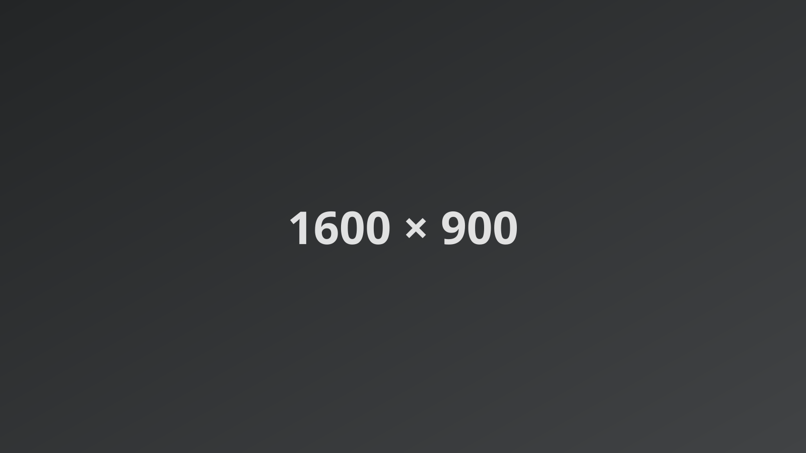
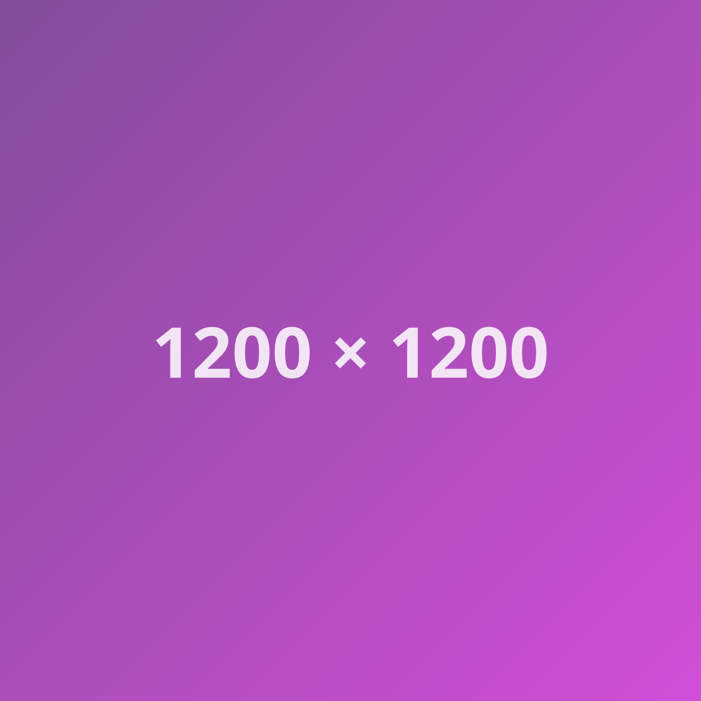

## Problem

Lorem ipsum dolor sit amet, consectetur adipiscing elit, sed do eiusmod tempor incididunt ut labore et dolore magna aliqua. Ut enim ad minim veniam, quis nostrud exercitation ullamco laboris nisi ut aliquip ex ea commodo consequat.

Duis aute irure dolor in reprehenderit in voluptate velit esse cillum dolore eu fugiat nulla pariatur. Excepteur sint occaecat cupidatat non proident, sunt in culpa qui officia deserunt mollit anim id est laborum.



## Constraints

- Sed ut perspiciatis unde omnis iste natus error sit voluptatem.
- Nemo enim ipsam voluptatem quia voluptas sit aspernatur aut odit.
- Neque porro quisquam est, qui dolorem ipsum quia dolor sit amet.

## Decisions

At vero eos et accusamus et iusto odio dignissimos ducimus qui blanditiis praesentium voluptatum deleniti atque corrupti. Nam libero tempore, cum soluta nobis est eligendi optio cumque nihil impedit `quo minus` id quod maxime placeat.

```ts
const lorem = (ipsum: string) => ipsum.split(" ").map((word) => word.length);
```

> Temporibus autem quibusdam et aut officiis debitis aut rerum necessitatibus saepe eveniet ut et voluptates repudiandae sint.



## Outcome

Itaque earum rerum hic tenetur a sapiente delectus, ut aut reiciendis voluptatibus maiores alias consequatur aut perferendis doloribus asperiores repellat.
